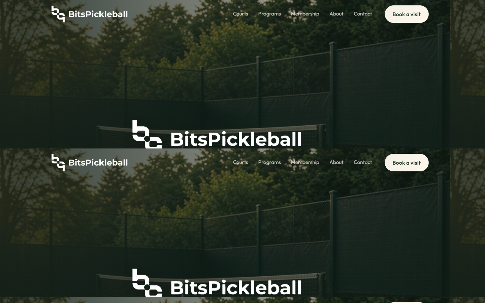
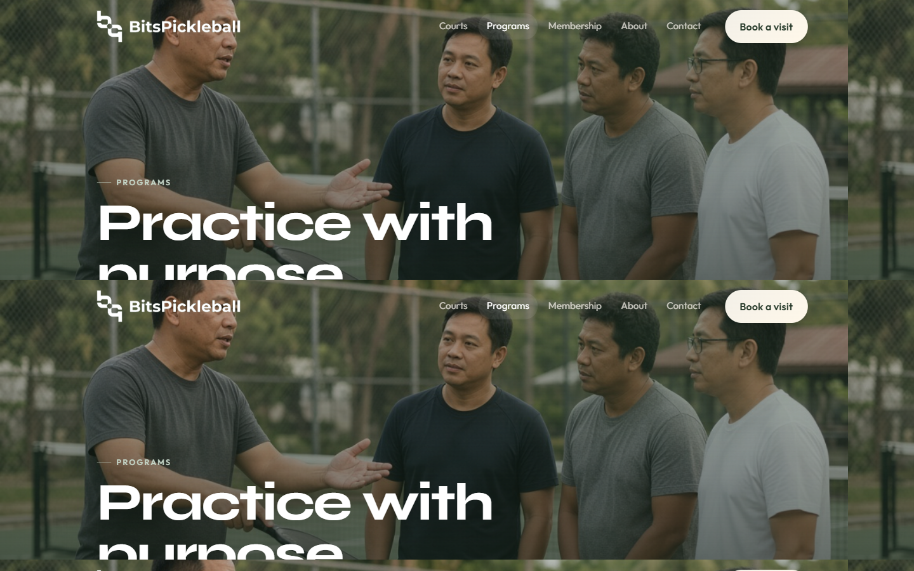
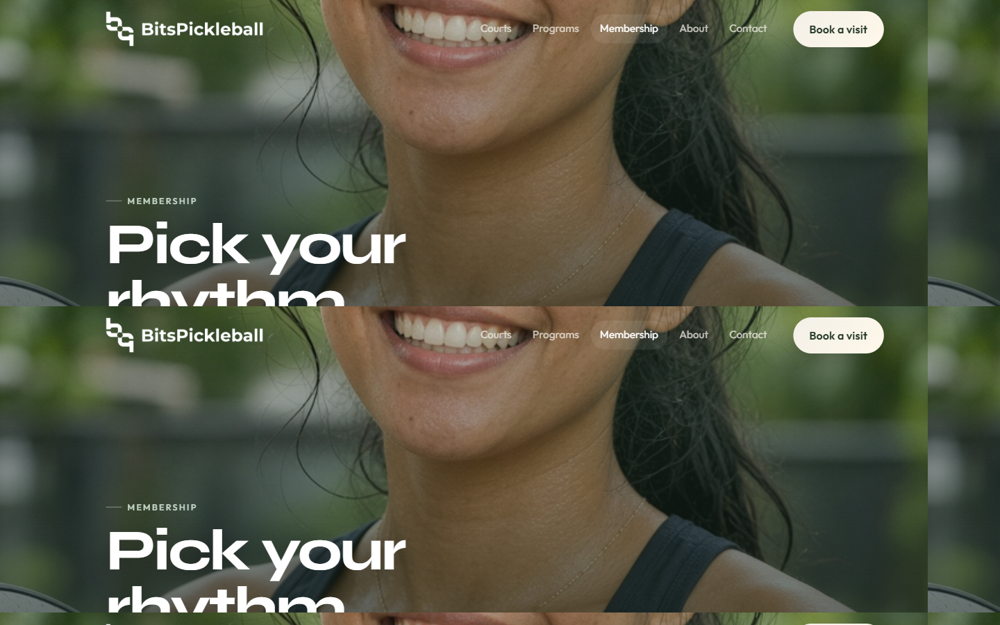
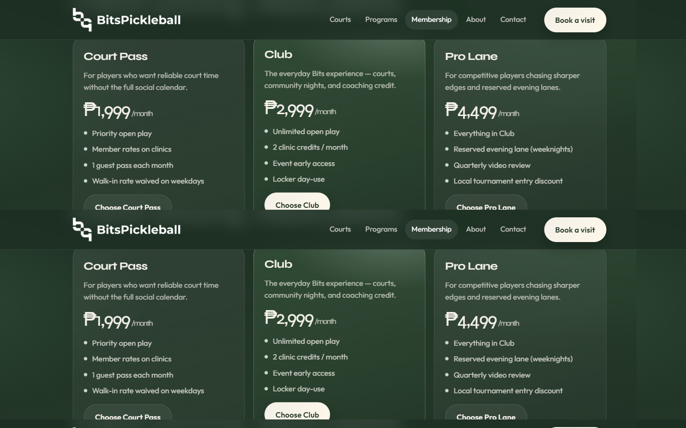
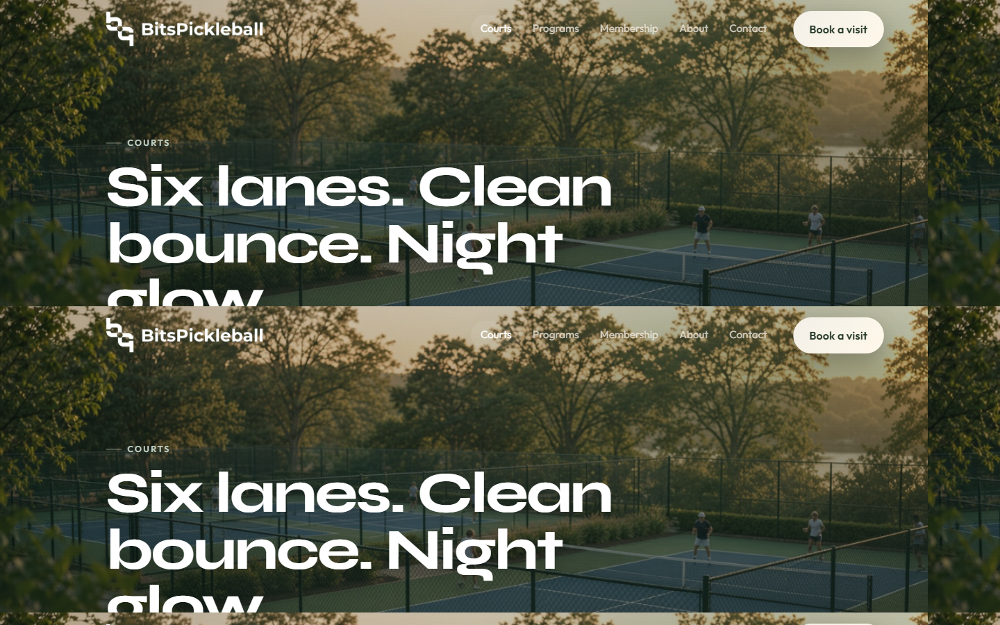
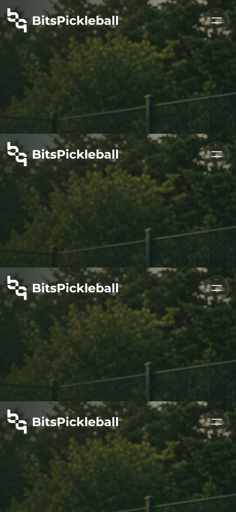
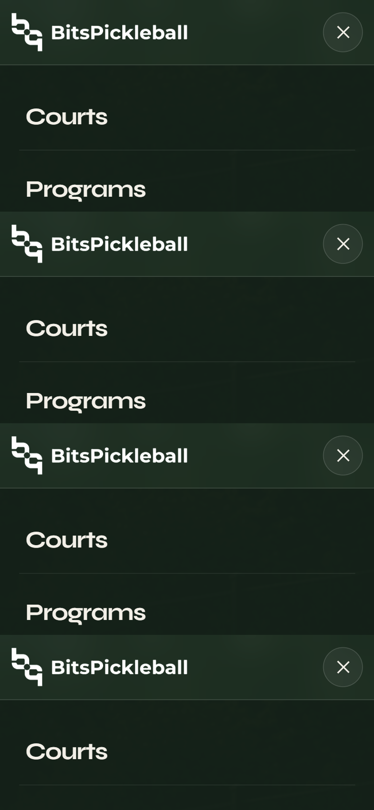

<p align="center">
  
</p>

<h1 align="center">BitsPickleball</h1>

<p align="center">
  <strong>Forest-green clubhouse energy for Hi-ka, Compostela, Cebu.</strong><br/>
  A premium multi-page marketing site — animated icons, smooth scrolling, peso pricing, and a mobile-first club experience.
</p>

<p align="center">
  
  
  
  
</p>

---

## Preview

### Home

<p align="center">
  
</p>

<p align="center"><em>Hero with brand wordmark, court photography, and clear CTAs.</em></p>

### Programs

<p align="center">
  
</p>

<p align="center"><em>Open play, skill clinics, and private coaching with local pricing.</em></p>

### Membership

<p align="center">
  
</p>

<p align="center">
  
</p>

<p align="center"><em>Monthly plans in ₱ — Court Pass, Club, and Pro Lane — plus walk-in rates.</em></p>

### Courts

<p align="center">
  
</p>

<p align="center"><em>Facility story for Hi-ka courts, night play, and clubhouse calm.</em></p>

### Mobile

<p align="center">
  
  &nbsp;&nbsp;
  
</p>

<p align="center"><em>Responsive hero and full-width mobile navigation with Book a visit CTA.</em></p>

---

## What’s inside

| Area | Details |
| --- | --- |
| **Pages** | Home, Courts, Programs, Membership, About, Contact |
| **Motion** | Framer Motion reveals + independently animated SVG icons |
| **Scroll** | Lenis smooth scrolling and route transitions |
| **Brand** | Official BitsPickleball mark + wordmark |
| **Locale** | Hi-ka, Compostela, Cebu · PHP pricing · PH contact format |
| **Backend** | Placeholder folder ready for the upcoming API |

---

## Project structure

```text
bits-pickleball/
├── frontend/          React + TypeScript (Vite)
│   ├── public/        Brand assets + photography
│   └── src/           Pages, layout, icons, styles
├── backend/           API placeholder
└── docs/screenshots/  README previews captured from the live app
```

---

## Quick start

```bash
# from repo root
npm run dev
```

Or run the frontend directly:

```bash
cd frontend
npm install
npm run dev
```

Then open [http://localhost:5173](http://localhost:5173).

### Scripts

| Command | Description |
| --- | --- |
| `npm run dev` | Start Vite dev server |
| `npm run build` | Typecheck + production build |
| `npm run preview` | Preview the production build |

---

## Stack

- **React 19** + **TypeScript**
- **Vite 8**
- **React Router**
- **Framer Motion**
- **Lenis**
- **Syne** + **Outfit** variable fonts

---

## Local club details (current copy)

- **Location:** Hi-ka, Compostela, Cebu, Philippines  
- **Membership:** ₱1,999 · ₱2,999 · ₱4,499 / month  
- **Walk-in:** ₱250 weekday · ₱300 weekend · ₱600 / hour court rental  

Contact phone/email in the UI are placeholders — swap them when the real club numbers are ready.

---

## Notes

- Frontend is the marketing site for now.
- `backend/` is scaffolded for the next API phase.
- Screenshots in `docs/screenshots/` were captured from the running local app.

---

<p align="center">
  <sub>BitsPickleball · Compostela, Cebu</sub>
</p>
